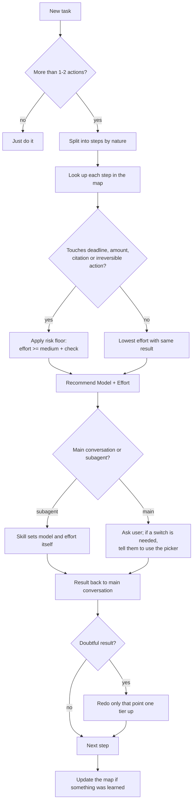

# Risk-Floor Model Routing

**A skill pattern for Claude that picks the model *and* the reasoning effort for each step of a task, with a minimum effort ("risk floor") wherever a mistake is expensive.**

[Português](README.pt-BR.md) · Related feature request: [anthropics/claude-code#108611](https://github.com/anthropics/claude-code/issues/108611)

---

## The short version

Routing work to the cheapest capable model is a well-known idea. Most setups decide by **complexity** or **cost**.

This pattern adds one more question before every step: **what does a mistake cost here?**

A step that copies a deadline, an amount or a quotation can be trivial and still must not be wrong. So the routing table carries a floor: those steps never run below medium effort, whatever model is chosen, and their output never moves on without a check.

The rest of the pattern is a set of small calibrations, learned from daily use in a professional-services workflow, that keep the routing cheap, predictable and under the user's control.

## What is already common

These pieces exist in many setups and are the base of this pattern:

- A table that maps types of activity to models (fast model for mechanical work, top model for reasoning).
- Subagents launched with an explicit model.
- Splitting planning and execution across models.

## What this pattern adds

| # | Calibration | What it does |
|---|---|---|
| 1 | **Risk floor on effort** | Steps involving deadlines, amounts, citations or anything irreversible never run below `medium`, and their output is checked before it is used. Cost decides everywhere else. |
| 2 | **Model and effort decided together, per step** | Every recommendation is a pair, `Model: X \| Effort: Y`, chosen per step instead of once per conversation. |
| 3 | **Lowest effort that gives the same result** | Default to the smallest effort that does not change the outcome. Long reasoning is spent only where an error means rework. Mechanical checks are done with targeted searches, not by re-reading. |
| 4 | **Escalate the point, not the step** | If a low or medium step returns something doubtful, only that point is redone at a higher tier, not the whole step. |
| 5 | **Clear split of labour** | Cheap subagents read, extract and search. The main conversation keeps judgment, final writing, the dialogue with the user and every irreversible action (submit, sign, send, delete). |
| 6 | **Honest human-in-the-loop switch** | The skill sets subagent models itself, but the main conversation's model is changed by the user in the app's picker, and the change only takes effect from the user's next message (tested: a switch made before clicking the answer did not apply to that same turn). So the question says it plainly: pick an option, switch in the picker, then send a one-word message such as 'go'. Ticking the option alone switches nothing. On that message the skill checks the session's model ID and warns once if the switch did not happen. |
| 7 | **A map that corrects itself** | User corrections, redone steps, a cheaper model that keeps delivering, new activities and new model releases all trigger an update of the table, logged with date and reason and proposed to the user for approval. |
| 8 | **No ceremony where it costs more than it saves** | Tasks of one or two actions skip the pre-flight. Unattended (scheduled) runs state the recommendation in one line and proceed. |

## How a task flows

## Example map

A neutral example. Replace the activities with your own; keep the floors.

| Activity | Model | Effort |
|---|---|---|
| Rename, move and organize files; simple folder searches | Haiku | low |
| Mechanical extraction into lists or tables | Haiku | low (checked if it feeds a risk step) |
| Reading long documents and summarizing them (read-only subagent) | Sonnet | medium |
| Checking sources, references and quotations against the original | Sonnet | medium (floor) |
| Drafting from an existing template | Sonnet | medium |
| Analysis that needs an argument or a decision; complex calculations | Opus | high |
| Final review before something is submitted or sent | Opus | high |
| High-stakes or novel work; long autonomous tasks where quality matters more than time | Fable | high (max only by exception) |

Model names follow the current Claude lineup and will change. The tiers matter more than the names.

## Adapting it to other fields

The risk floor is the part worth carrying over. Pick the categories where an error is cheap to make and expensive to discover:

- **Accounting and finance:** amounts, tax rates, filing dates.
- **Software:** database migrations, production configuration, anything touching secrets or deletes.
- **Research and publishing:** quotations, references, names and figures.
- **Operations and procurement:** contract dates, quantities, supplier identifiers.

Everything outside those categories can be routed purely by cost.

## Install

1. Copy [`skill/SKILL.md`](skill/SKILL.md) into a folder named `model-and-effort-routing`.
2. In Claude Code, place that folder in `.claude/skills/` (project) or `~/.claude/skills/` (personal). In the Claude app, add it as a custom skill.
3. Edit the map in section 3 and the floor categories in section 4 to match your work.

## Limitations

- **The main conversation's model and effort cannot be changed by a skill today.** The skill can recommend and ask; only the user can switch. Feature request [#108611](https://github.com/anthropics/claude-code/issues/108611) asks for a supported way to apply the user's own table automatically, with a visible notice and a manual override.
- The pattern lowers the chance of using the wrong tier. It does not replace checking the output.
- Model names, prices and limits change. Review the table when the lineup changes.

## License

[MIT](LICENSE). Use it, adapt it, and if you find a better calibration, open an issue or a pull request.
